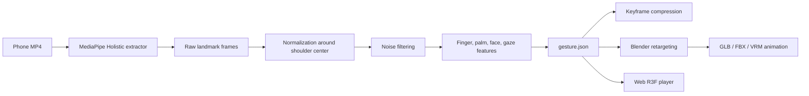

# Architecture

## Goal

VisualMind needs a scalable RSL dictionary that does not store gesture videos. Each source video is converted into reusable motion data and animation assets that can drive any compatible 3D avatar.

## Pipeline



## Stages

1. Capture motion with MediaPipe Holistic.
2. Normalize all coordinates relative to shoulder center and shoulder width.
3. Smooth noise with moving average, Kalman, or Savitzky-Golay filters.
4. Calculate hand-critical RSL features: finger joint angles, flexion, palm openness, and palm orientation.
5. Store the gesture as `gesture.json`.
6. Retarget normalized landmarks to an avatar armature in Blender.
7. Export `glb`, `fbx`, or VRM-compatible animation.
8. Play `gesture.json` in the web player. When a gesture is loaded the player *bakes* it: the arm and hand solvers run over the whole clip at 60 Hz, finger angles come from a bounded fit to human joint limits (`frontend/src/finger-fit.ts`), tracker glitches and impossible jumps are dropped and bridged, and the rotation curves are filtered looking forward and backward in time (`frontend/src/motion-filter.ts`, `animation-bake.ts`). Arms are placed from where the picture shows each body point (`pose`, x and y) at the depth of `pose_world`, because the two disagree in height by up to a third of a shoulder width and contact signs are judged against the picture; a hand that is at the face is mapped through eyes and chin onto the avatar's face (`frontend/src/face-anchor.ts`), so a fist at the throat lands at the throat. Every hand, finger and forearm is then checked against the avatar's torso, measured off the avatar's skin when it loads (`frontend/src/body-shape.ts`), and pushed out in front of it (`frontend/src/body-contact.ts`), including the stretches where an arm is not tracked: those are eased in wrist-target space with the same check, because easing bone rotations sweeps the forearm through the body. A hand that touches the face or throat in the picture is brought onto the avatar's measured face surface, the touching point (one per touch, eased in and out) placed where it is on the signer's face. Arms hanging at rest are left at the rest pose, and so are arms whose wrist is out of the picture or below the chest with no hand seen, and the hands' final drop at the end of a clip (the pose guessed there holds the hands at the hips with the elbows out); on the way to or from rest the elbow comes in ahead of the wrist. A hand lost or dropped as glitches in mid-sign is bridged for up to 0.5 s instead of relaxing (which opened the fingers), and a hand moving faster than 10 palm lengths a second (blurred on video) keeps the shape and turn it had before and after. Hands close together in the picture are placed against each other as the picture shows (one fist on top of the other stays on top), palms that face each other side by side, and such hands are not taken for touching the face they are in front of; nor is a hand passing the throat fast (a sweep down past the chin, not a touch). In the final drop the arm follows the measured wrist down, blended toward rest by how far it has come. Pressed palms meet in an upright plane (the backend levels the contact plane). Finally the wrist and elbow paths are cleaned of jumps (a step far beyond the surrounding speed becomes an eased transition) and smoothed in space, and the arms are re-aimed along them; rotation curves get the same jump easing, with short finger pulses (a tap) kept. Playback then only reads the finished curves at the video's clock, so the avatar has no lag, no frame-rate dependence, and holds still while a hand holds a shape. The same curves are what a GLB/FBX animation export would contain. The face is baked the same way (`frontend/src/face-expression.ts`): the `expression` track's blendshape weights drive the avatar's shapes of the same names (the signer's resting face taken off, short blinks kept), the eyes turn with the gaze, and the neck and head turn with the signer's head relative to their usual pose, held mostly still while a hand touches the face so the contact stays where it was solved.

## Gallery of many signs

`frontend/gallery.html` (`/gallery.html` on the dev server) shows many signs at once, each video next to its avatar
in step (avatar, camera from the front or side, 1×/0.5×/0.25× for all). It reads `frontend/public/gallery/signflow.json`,
written by `tools/signflow_batch.py`, which takes dictionary videos from signflow.ru (used by agreement with its
owners): each has the sign four times (front normal speed, front slowed, side normal, side slowed) joined by hard cuts;
the first part is cut out (a cut is a single frame that differs far more than its neighbours, which a fast hand does
not) and sent through the backend like an upload. Originals are kept in `data/signflow/`. Each card has its own player (nothing
autoplays, starting one pauses the others, a paused card's canvas draws only on demand). The slowed part is not used:
measured on Алкоголь/Хорошо/Знать it is the same 30 fps take with every frame shown twice (consecutive frames differ by
compression noise only), and hand landmarks from it differ from the normal part's by 1–3 px at 1080p with one extra
tracked frame in total, so it carries no extra information about the fingers.

Videos for sharing: `tools/export_videos.py [--avatar male|female]` renders each gallery sign's avatar frame by frame
through `/render.html` (at the original clip's frame times) and composes word on top, original left, avatar right into
`exports/signflow-<avatar>/NN_<word>.mp4`.

## Production Data Flow

- Store original videos only in a short-lived ingestion bucket.
- Persist `gesture.json`, animation exports, checksums, and metadata.
- Generate embeddings asynchronously from normalized features for search and recognition.
- Deduplicate gestures by word, signer profile, language variant, and motion fingerprint.

## Scaling to 10,000+ Gestures

- Use object storage for `gesture.json` and animation binaries.
- Store metadata and indexable fields in PostgreSQL.
- Store embeddings in a vector database such as pgvector, Qdrant, or Milvus.
- Compress motion by keyframes, delta encoding, and duplicate-frame removal.
- Keep MediaPipe raw landmarks optional; normalized and feature tracks are the canonical source.

## Future AI Layer

```text
Video -> MediaPipe -> Gesture JSON -> Embedding -> Similar gesture search -> RSL recognition -> New gesture generation
```

The `features` and `normalization` sections in `gesture.json` are designed so embeddings can be generated without reprocessing the original video.

The avatars themselves are built reproducibly from CC0 MakeHuman assets, with ARKit face blendshapes; see `docs/AVATARS.md`.
