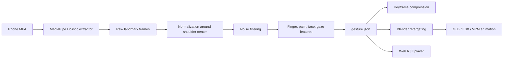

# Architecture

## Goal

VisualMind needs a scalable RSL dictionary that does not store gesture videos. Each source video is converted into reusable motion data and animation assets that can drive any compatible 3D avatar.

## Pipeline



## Stages

1. Capture motion with MediaPipe Holistic.
2. Normalize all coordinates relative to shoulder center and shoulder width.
3. Smooth noise with moving average, Kalman, or Savitzky-Golay filters.
4. Calculate hand-critical RSL features: finger joint angles, flexion, palm openness, and palm orientation.
5. Store the gesture as `gesture.json`.
6. Retarget normalized landmarks to an avatar armature in Blender.
7. Export `glb`, `fbx`, or VRM-compatible animation.
8. Play `gesture.json` in the web player. When a gesture is loaded the player *bakes* it: the arm and hand solvers run over the whole clip at 60 Hz, finger angles come from a bounded fit to human joint limits (`frontend/src/finger-fit.ts`), tracker glitches and impossible jumps are dropped and bridged, and the rotation curves are filtered looking forward and backward in time (`frontend/src/motion-filter.ts`, `animation-bake.ts`). Arms are placed from where the picture shows each body point (`pose`, x and y) at the depth of `pose_world`, because the two disagree in height by up to a third of a shoulder width and contact signs are judged against the picture; a hand that is at the face is mapped through eyes and chin onto the avatar's face (`frontend/src/face-anchor.ts`), so a fist at the throat lands at the throat; sideways it keeps its place against the width of the face (face mesh cheek points against the avatar's measured cheeks; the stylized avatars' eyes are set 14% wider than a person's, and scaling by them put a hand cupped at the ear 3 cm out). The pose model's depth for a raised hand is often far too much forward, so a hand whose palm overlaps the head in the picture or is right beside it is held to the head's depth: at most 0.35 shoulder widths ahead of the eyes in front of the face, 0.12 beside it (a hand at the temple otherwise floated in front of the head and, seen from the front, above it). With the camera close (a phone at arm's length, as in the Slovo recordings) a hand's size tells how far before the face it is (`frontend/src/hand-distance.ts`): the landmarker's 3D palm against the face mesh's 3D eye span is a per-person constant while the hand is at the face's depth (taken per clip as a low percentile) and grows as the hand comes toward the camera; a hand at least 16% bigger than that is taken to be in front of the face by the camera distance times the share it grew, so a claw held out before the mouth ("волк") or hands before the face ("аллигатор") are not pressed onto it and do not count as touching it. The camera distance comes from how much of the picture the signer fills; with a studio camera (signflow.ru, 2.8-4.4 shoulder widths away) the measurement is not used, since its scatter would be a large error there. Over the eyes a hand keeps its height against the size of the face, as between chin and eyes, up to one and a half face heights above the eyes (horns at the temples stay at the temples although a phone close by shows the head a fifth bigger against the shoulders); higher, an arm held up, it moves with the head. A hand before the trunk is placed in depth the same way, by its size, against the front of the body (`handsAheadOfBody`): the ratio of a hand at the body is per person between 0.88 and 1.07 (palms flat on the chest read 0.88 to 1.0), so each clip takes a low percentile of its own ratios within those bounds, and a hand whose deepest point (by the hand's 3D shape) reads within 0.08 shoulder widths of the body, or behind it, is set with that point on the avatar's front (the middle fingertip on the chest in "беспокоящий", the palm in "активный"); the pose model's depth is no measure there (a palm flat on the chest came out a third of a shoulder width further forward than a hand held out before the face). This is done only for a hand near the body (its palm up to 0.3 shoulder widths before it, fading out at 0.6), not low on the lap or coming up into the picture, and smoothed over about a tenth of a second: a hand held out far forward keeps the pose model's depth, since put as far forward as its size says (the fingers of "аллигатор" 1.9 shoulder widths before the shoulders) it came out big and low in the player, which looks at the avatar from further away than the phone did, and the reading of a fist up close jumped from frame to frame. Below the chin that distance also undoes the close camera's perspective sideways: a hand three quarters of a shoulder width nearer the camera than the shoulders shows a third further from the picture's middle than it is, and taken at the shoulders' scale it put a hand across the body further than the avatar's forearm (as long against its shoulders as a person's) reaches with the elbow at its side, so in "адаптивное поведение" (arms folded before the belly, the forearm spanning 1.06 shoulder widths in the picture) the avatar held its elbows out before its chest; the wrist and, half as much, the elbow are moved toward the picture's middle by the share the camera's distance shrinks over theirs. Heights are left as the picture shows them: the avatar is seen from in front at chest height and compared with the picture. Every hand, finger and forearm is then checked against the avatar's torso, measured off the avatar's skin when it loads (`frontend/src/body-shape.ts`): the front of the trunk as a height map seen from the front, where an ellipse fitted to the trunk took its depth from a hoodie's pocket and hood and held hands on the chest 7 to 10 cm off it and crossed forearms off the belly. Each part is pushed out in front of it (`frontend/src/body-contact.ts`), including the stretches where an arm is not tracked: those are eased in wrist-target space with the same check, because easing bone rotations sweeps the forearm through the body. A hand that touches the face or throat in the picture (the face reaching up to the hairline where the face mesh shows it, so fingertips on the forehead count: "чёрный"; the throat down to 0.6 of the eye-to-chin height below the chin, as further down a hand is on the collar or the chest: pulled onto the avatar's throat, the palm on the chest in "активный" rose to the neck and the two fingers at the collarbones in "воротник" met and crossed in the middle) is brought onto the avatar's measured face surface, the touching point (one per touch, eased in and out) placed where it is on the signer's face; sideways and up-down it slides the hand at most 0.2 shoulder widths over all contact rounds, and it never folds the arm shorter than 0.3 of its length (a hand held before the face, as in the numbers, overlaps it in the picture without touching it; pulled onto it, the wrist came to the shoulder with the elbow thrown up). Arms hanging at rest are left at the rest pose, and so are arms whose wrist is out of the picture or below the chest with no hand seen, and the hands' final drop at the end of a clip (the pose guessed there holds the hands at the hips with the elbows out); on the way to or from rest the elbow comes in ahead of the wrist. A hand caught only for a moment below the chest (up to 0.75 s, the wrist never higher than 0.6 shoulder widths under the shoulder line) is a hand resting on the lap, not signing, and is ignored, and an arm that leaves rest only for such a moment stays at rest: followed, these glimpses swung the idle arm in front of the body and back. A hand lost or dropped as glitches in mid-sign is bridged for up to 0.5 s instead of relaxing (which opened the fingers), and a hand moving faster than 10 palm lengths a second (blurred on video) keeps the shape and turn it had before and after. Hands close together in the picture are placed against each other as the picture shows (one fist on top of the other stays on top), palms that face each other side by side, and hands that come close elsewhere keep the gap between their closest points (in palm lengths: the avatar's fingers are shorter against its palm than a person's, and fingertips held a little apart at the collar crossed; shared over the pairs about as close as the closest and smoothed in time, as the closest pair changes from frame to frame when one hand holds the other), and such hands are not taken for touching the face they are in front of; nor do the avatar's two hands go through each other's palms: crossed at the wrists ("бабочка") or stacked ("соты") they lay at one depth, the picture giving only where they are across it, and one palm went through the other, so where balls along one hand's palm and its fingers' first bones come nearer the other's than their radii, the hand that has the least way to go is moved in front until they only touch (at most 0.2 shoulder widths, the other back for the rest; fingers lacing and thumbs hooking round each other are left alone); nor is a hand passing the throat fast (a sweep down past the chin, not a touch). In the final drop the arm follows the measured wrist down, blended toward rest by how far it has come. Pressed palms meet in an upright plane (the backend levels the contact plane). Finally the wrist and elbow paths are cleaned of jumps (a step far beyond the surrounding speed is spread over the samples around it: the path either side is shifted towards the other, not drawn straight across, so a hand that rises to the chin between two jumps in depth still rises) and smoothed in space, and the arms are re-aimed along them; rotation curves get the same jump easing, with short finger pulses (a tap) kept. Playback then only reads the finished curves at the video's clock, so the avatar has no lag, no frame-rate dependence, and holds still while a hand holds a shape. The same curves are exported for other sites as three.js animation clips (`tools/export_clips.py` through `/clip.html`, into `tilmind-signs/`: per sign and avatar the bones' rotations and the face shapes' weights at 60 samples a second; each clip is checked by playing it back). The face is baked the same way (`frontend/src/face-expression.ts`): the `expression` track's blendshape weights drive the avatar's shapes of the same names (the signer's resting face taken off, short blinks kept), the eyes turn with the gaze, never quite still (a microsaccade of a degree or two every 0.5 to 1.6 s, seeded by the word), the upper lids riding on them (down with a look down, up a little with a look up), and the neck and head turn with the signer's head relative to their usual pose, held mostly still while a hand touches the face so the contact stays where it was solved. For a word whose stress is known (`frontend/src/mouthing.ts`, so far the nine words of the 2026-11-11 review) the mouth is not copied but the word is said with the lips: signers mouth the word along with the sign, some clearly and some hardly at all, and copied from a phone video their mouth was too faint to read. The word's sounds come from Russian reading rules with its stress (unstressed о/а said half open before the stress and barely further away, unstressed е/я near и, я/е/ю/ё with a й at the start of a word and after a vowel, double consonants one long sound), each sound becomes one of 18 visemes (б/п/м, ф/в, т/д/н, с/з/ц, ш/ж/ч/щ, л, р, к/г/х, й, а, the two reduced а, the unstressed о, о, у, э, и, ы; the unstressed о is said as а or a schwa but shown with the lips a little rounded and held as long as a full vowel, since a lip reader looks for the о of the written word: without it the start of "водоплавающее" could not be read while its stressed rest could) posed with the avatar's ARKit mouth shapes, chosen off renders of both avatars to look unlike each other (lip reading tells little more than the jaw's opening, rounded lips, spread lips, lips shut and the lower lip under the teeth, so those are made large; the small openings of и, т, с, й are set far enough that the man's lips, which meet more fully at rest, part too). Each sound holds its pose over the middle 45% of its time and eases into the next over the rest; the consonants that do not show on the lips (т/д/н, к/г/х, л, р; б/п/м and ф/в for rounding only) leave the lips' rounding and spread to the vowels around them, so the lips round ahead of an у. Blended instead as a weighted mean of all sounds around (the first prototype), the shapes never reached their poses and every word read as the mouth opening and closing. The word is spoken over the sign (the stretch a hand is up), slowly as to a lip reader, at 1.3 to 2.6 times an ordinary pace (said at an ordinary pace a sound lasted 4 to 6 frames), and kept within the clip. Both faces were modelled with the corners of the mouth turned up, and every open shape read as a grin: a frown on the vowels and slack consonants levels them, and the signer's smile is kept under the word at 0.3 of its weight. The tongue takes part (the avatars' `tongueTipUp`, `tongueBackUp`, `tongueFrontUp`, see docs/AVATARS.md): the tip on the ridge behind the upper teeth for т, д, н, л, р (half way for с, з, with the back raised for ш, ж), the back up for к, г, х (less for ы, у, о), the front up for и, й, э, low for а; б, п, м and в, ф leave it where the next vowel wants it. The poses are set for the avatars' mouth of 2026-11-11, whose jaw turns the whole mandible and whose lip shapes lift the lips off the teeth, so the teeth show for и, э, с, з and the open vowels rather than on every sound. The brows, eyes, cheeks and head stay the signer's. `/words.html` has a face close-up ("Лицо") to read the lips, and `/render.html?view=face` the same for checks.

## Hands from WiLoR

MediaPipe's hand models lose hands that touch, cover each other or blur: two fists held together come out as one hand
on both tracks ("верблюд"), a hand behind the other is missing ("аллигатор"), and a hand held still wanders by up to 50
degrees ("вилять"). The hand tracks are therefore taken from WiLoR where it was run: a model that fits a whole hand
(MANO) to each picture, so every hand it returns has a possible shape, also where part of it is hidden, with depth as
good as the other axes. It needs PyTorch and a GPU and runs apart from the backend, in its own environment:

    .venv-wilor/bin/python tools/wilor/track.py VIDEO ...      # writes data/hands/<sha1 of the video>.npz

(`.venv-wilor`: Python 3.12 with torch 2.5, ultralytics 8.1.34, smplx, dill, chumpy and WiLoR-mini from GitHub; the
weights come from Hugging Face on first use; mediapipe is installed there too, for the body pose.) Its detector finds
at most one left and one right hand per frame; a hand it loses for up to half a second between two sightings (covered
by the other hand, blurred) is still estimated, in a box between the ones around it, and a detection of the wrong side
where the other hand was is given to that hand. The detector alone mistakes sides and things for hands, so each
detection is checked against the body pose of the same frame: one that lies at one wrist of the pose and well away from
the other is that arm's hand whatever the detector called it, one far from both wrists is not a hand of the signer, a
hand does not move more than one and a half of its box sizes in a frame, and a left and a right hand lying on each
other while the pose has the other wrist elsewhere are one hand read twice (the copy on the wrong arm is dropped). When
the backend processes a video that has such a file (`rsl_gesture/hand_wilor.py`), both hand tracks come from it, in the
same units as MediaPipe's (the picture's x and y, depth relative to the wrist scaled to the picture), the repairs made
for MediaPipe's mistakes (turned-over hands, merged hands) are skipped, and the gesture says
`normalization.hand_source: "wilor"`. The player then aims every finger segment where it was measured instead of
fitting hinges to it, and does not close a half-closed hand into a fist (`hand-solver.ts`, `wholeHand`); the guards
made for MediaPipe's hands (dropping impossible turns, holding the shape through blur) are off, as they removed real
fast turns. The arm brings the wrist to where the hand track has it, not where the pose model does (`wristShifts` in
`animation-bake.ts`): the pose's wrist is a separate guess, 0.06 shoulder widths from the hand's on average and over
0.3 in one frame of sixty, at times on the wrong arm, and with it hands that touch in the video did not touch on the
avatar (pressed palms in "адаптивный", the fists of "верблюд"). Measured over the 698 hands of the gallery's 430
signs, the avatar's wrist is 0.05 shoulder widths from the tracked one (median; 0.09 with the pose's wrist, on a sample
of 64 hands), with the same steadiness; its finger segments point 2.9 degrees off the measured ones and its palm 2.5.
WiLoR reads every frame on its own, and a hand blurred by fast movement it reads with less care, so its hands are
cleaned against the frames around them before they are stored (`hand_wilor.py`). A palm that turns more than 90
degrees in a frame and back within six frames was read from the wrong side (one to four frames, 120 to 170 degrees
off, in 97 of the 698 hands, e.g. "водоплавающее", "аллигатор": the avatar's palm flapped over and back) and those
frames are dropped (also a hand hidden behind the other one, read turned over for five frames in "тигр": up to six frames are taken). The palm's turn is otherwise left as read: smoothed against the sharp frames, the quick back-and-forth turns of the palms in "бабочка" (the wings flapping, 15 to 20 degrees every three to five frames, all blurred) were taken for misreadings and the wings stood still. And each finger's shape is taken from the frames within 0.1 s either way, weighted by how sharp
the hand is in each (the strongest edges in the hand against the spread of its brightness, relative to the hand's
sharper frames, to the fourth power) and by distance in time: the shape most of that weight agrees on, averaged over
the frames that agree with it within 25 degrees per bone. The palm stays as read; the fingers keep each frame's bone
lengths. In "вилять" the index finger wagged side to side is straight in every sharp frame and was read hooked in most
blurred ones, so on the avatar it vanished into a fist; fingers shook 3 to 18 degrees from frame to frame in the
signs reviewed and now 0.4 to 6, while a shape the sharp frames hold (the jaws of "аллигатор" opening and closing)
stays. Body and face still come from MediaPipe. Without the file everything works as before. `tools/reprocess.py signflow|slovo` sends the gallery's stored clips through the pipeline
again. **Licence:** WiLoR's weights (CC BY-NC-ND) and the MANO hand model are for non-commercial use only; commercial
use of animations made with them needs a licence from their owners or another tracker.

## Gallery of many signs

`frontend/gallery.html` (`/gallery.html` on the dev server) shows many signs at once, each video next to its avatar
in step (avatar, camera from the front or side, 1×/0.5×/0.25× for all). It reads `frontend/public/gallery/signflow.json`,
written by `tools/signflow_batch.py`, which takes dictionary videos from signflow.ru (used by agreement with its
owners): each has the sign four times (front normal speed, front slowed, side normal, side slowed) joined by hard cuts;
the first part is cut out (a cut is a single frame that differs far more than its neighbours, which a fast hand does
not) and sent through the backend like an upload. Originals are kept in `data/signflow/`. Each card has its own player (nothing
autoplays, starting one pauses the others, a paused card's canvas draws only on demand). The slowed part is not used:
measured on Алкоголь/Хорошо/Знать it is the same 30 fps take with every frame shown twice (consecutive frames differ by
compression noise only), and hand landmarks from it differ from the normal part's by 1–3 px at 1080p with one extra
tracked frame in total, so it carries no extra information about the fingers.

`/gallery.html?set=slovo` shows the signs taken from the Slovo dataset (github.com/hukenovs/slovo, CC BY-SA 4.0 variant: 20 recordings per word by many performers, phone videos), from `frontend/public/gallery/slovo.json` written by `tools/slovo_batch.py`. For each word one recording is chosen (`tools/slovo/`): every recording of the word is screened with MediaPipe (person whole in the picture, hands found and inside it, hand size), the recordings are compared by their wrist paths and hand shapes (DTW) and the most typical one is taken, preferring the two performers filmed best (Full HD, seated, camera at chest height). Many recordings are mirrored selfies or left-handed: signed with MediaPipe's left hand (signflow.ru: 88 signs with the right, 2 with the left) they are flipped, so the avatar signs with its right hand throughout. The chosen recording is then cut from Slovo's untrimmed video so that the hands start and end at rest (the trimmed clips begin and end mid-movement), stopping before the performer reaches for the phone.

`frontend/words.html` (`/words.html`) is the viewer for going through every sign: both batches in one alphabetical list
(430 entries; nine words are in both batches and are listed twice, by source) with a search and a source filter, and one
large player with the chosen word's video next to the avatar, which starts once the avatar's animation is ready. Arrow
keys step through words and frames; at the end of a word it repeats, moves to the next word or stops; the avatar is
turned with the mouse; the video can be shown whole instead of cropped to the signer. The address keeps the word
(`#slovo/alligator`). `?list=<name>` shows only the words of `frontend/public/gallery/lists/<name>.json` (`{ title, items: ["set/slug", ...] }`) in that order: a reviewer's set of words to look at again (`zamechaniya-11-11`: the nine words of the 2026-11-11 review). Notes are the gallery's own (same browser storage, `frontend/src/sign-sets.ts`). `tools/viewer.sh`
starts the backend and the dev server if they are not running and opens the page; `tools/viewer.sh stop` stops them.

Videos for sharing: `tools/export_videos.py [--avatar male|female]` renders each gallery sign's avatar frame by frame
through `/render.html` (at the original clip's frame times) and composes word on top, original left, avatar right into
`exports/signflow-<avatar>/NN_<word>.mp4`.

## Production Data Flow

- Store original videos only in a short-lived ingestion bucket.
- Persist `gesture.json`, animation exports, checksums, and metadata.
- Generate embeddings asynchronously from normalized features for search and recognition.
- Deduplicate gestures by word, signer profile, language variant, and motion fingerprint.

## Scaling to 10,000+ Gestures

- Use object storage for `gesture.json` and animation binaries.
- Store metadata and indexable fields in PostgreSQL.
- Store embeddings in a vector database such as pgvector, Qdrant, or Milvus.
- Compress motion by keyframes, delta encoding, and duplicate-frame removal.
- Keep MediaPipe raw landmarks optional; normalized and feature tracks are the canonical source.

## Future AI Layer

```text
Video -> MediaPipe -> Gesture JSON -> Embedding -> Similar gesture search -> RSL recognition -> New gesture generation
```

The `features` and `normalization` sections in `gesture.json` are designed so embeddings can be generated without reprocessing the original video.

The avatars themselves are built reproducibly from CC0 MakeHuman assets, with ARKit face blendshapes; see `docs/AVATARS.md`.
